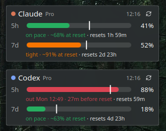

# AI usage widgets for KDE Plasma 6

Desktop widgets showing your Claude Code and Codex plan limits: 5-hour and 7-day bars, a tick for where even use
would be, and a pace verdict ("on pace · ~60% at reset" / "out Thu 14:20 · 6h before reset").



## Requirements

- KDE Plasma 6 (any distro)
- python3 (standard library only)
- [Claude Code](https://claude.com/claude-code) and/or [Codex CLI](https://github.com/openai/codex), logged in

## Install

```sh
./install.sh            # all widgets
./install.sh claude     # only some
```

The installer restarts the Plasma shell (Plasma caches widget QML), so panels and desktop blink once.
Then right-click the desktop → *Add Widgets* → "Claude Usage" / "Codex Usage".

Plans without a 5-hour limit (Claude Ultra since Oct 2026, once the account is verified) show only the 7-day bar.

Widgets refresh every 5 min. Click one, or its ↻ button, to refresh now.

Uninstall:

```sh
kpackagetool6 -t Plasma/Applet -r aiusage.claude   # and/or aiusage.codex
rm ~/.local/bin/ai-usage
```

## How it works

- `ai-usage.py <provider>`: reads the CLI's local login and calls the same usage endpoint the CLI uses. Read-only,
  costs no tokens, never refreshes logins. Prints JSON. Errors are logged to `~/.local/state/ai-usage/errors.log`.
- `widgets/<provider>/`: one Plasma applet per provider, which runs `ai-usage <provider>`.

**Caveat:** these endpoints are undocumented and internal. They change without notice, and when they do, a widget
shows an error until the script is fixed.

## Adding a provider

Each provider has its own limit rules, so each gets its own function and its own widget. The widgets are
deliberately full copies rather than a shared component: each one can change its layout without touching the others.

1. `ai-usage.py`: add a function and register it in `PROVIDERS`. The block above `PROVIDERS` has the steps and a stub.
2. `cp -r widgets/_template widgets/<provider>` and fix the `TODO`s in `contents/ui/main.qml`. In `metadata.json`,
   replace `PROVIDER` / `NAME`.
3. `./install.sh`

Test with `python3 ai-usage.py <provider>` before touching QML.

## License

MIT
